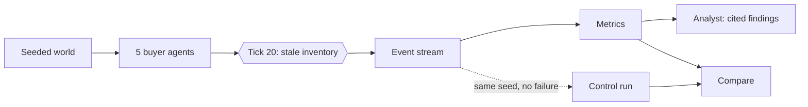
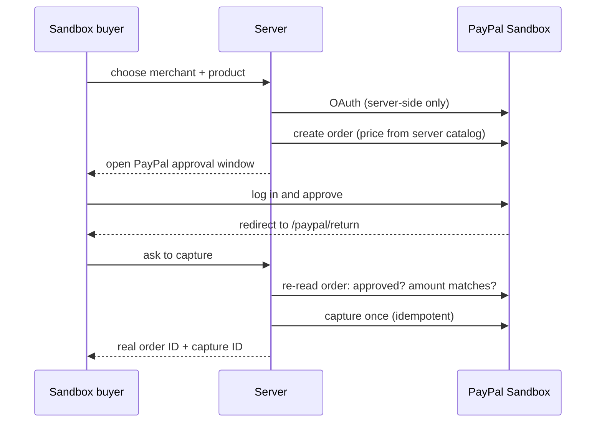

<div align="center">

# Agent Driven Commerce Simulator

**Five autonomous buyers. One shared market. Unexpected consequences.**

    

*Product name: **Commerce Wind Tunnel** = Test the economy before the economy runs itself.*
*Built for the PayPal AI Hackathon 2026.*

</div>

An experimental environment for exploring what happens when autonomous agents make independent purchasing decisions inside a shared digital economy.

Different agents. Different priorities. Limited inventory. Competing merchants. Hidden disruptions.

Each agent optimizes for its own objectives, but the consequences don't stay local. Their interactions can produce market-wide effects that no individual agent intended.

**This isn't an AI shopping assistant. It's a laboratory for studying the behaviour of autonomous commerce.**

> *Individual intelligence can produce unpredictable collective outcomes.*

<!-- Add after you take them:   -->

---

## What it does

1. **Create** a seeded world: 3 merchants, 10 products, 5 buyer agents with different personalities.
2. **Run** it. Every agent decision, purchase, failure and merchant switch is recorded as an event.
3. **Break** it. At tick 20 a hidden *stale inventory* failure hits one merchant: listings still show stock that no longer exists.
4. **Discover** what emerged. Metrics (demand concentration, conversion, merchant switches) and an analyst whose findings must cite real event IDs.
5. **Compare** against a control run on the same seed with no failure.
6. **Pay for something for real** in the PayPal Sandbox, approved by a human buyer.



## The agents

| Agent | Personality | Under failure |
|---|---|---|
| BudgetBot | budget hunter | follows price, tolerates retries |
| ReliableRoger | reliability-first | distrusts a failing merchant quickly |
| ImpatientIvan | impatient | switches merchants after few failures |
| LoyalLisa | loyal | absorbs the most failures before leaving |
| BalancedBea | balanced | weighs price, speed and trust |

Agents only see **listed** inventory, never actual inventory. That gap is the whole experiment.

## What's real and what's simulated

| Part | Status |
|---|---|
| Agents and their purchases | **Simulated.** Deterministic, seeded, uses `SimulatedPaymentProvider`. |
| PayPal Sandbox Proof panel | **Real** calls to `api-m.sandbox.paypal.com`: OAuth, create order, human approval, capture, refund. Test money only. |
| Analyst | Uses Groq when `GROQ_API_KEY` is set; otherwise a deterministic analyst. The model used is always shown on screen. Cited event IDs are validated against the run. |
| Playback animation | **Recorded playback** of events the engine already produced, not a live stream. |

<details>
<summary><b>How the PayPal checkout is protected</b></summary>



Unit-tested rules: price never comes from the browser · capture only after PayPal reports approval · duplicate or concurrent capture calls hit PayPal once · orders are only actionable by the session that created them · secrets stay server-side · the Sandbox base URL is hard-coded.
</details>

## Run it

```bash
git clone https://github.com/SWARNIM-TIWARI/agent-driven-commerce-simulator
cd agent-driven-commerce-simulator
npm install
cp .env.example .env.local     # add Sandbox keys, optionally GROQ_API_KEY
npm run dev                    # http://localhost:3000
```

| Command | Purpose |
|---|---|
| `npm test` | 49 tests: engine, agents, replay integrity, PayPal safety rules |
| `npm run simulate` | Run Experiment 001 in the terminal |
| `npx tsx scripts/paypal-smoke.ts` | Real Sandbox OAuth + order creation |

<details>
<summary><b>Environment variables</b></summary>

| Name | Required | Notes |
|---|---|---|
| `PAYPAL_MODE` | yes | must be `sandbox` |
| `PAYPAL_CLIENT_ID` | yes | Sandbox REST app |
| `PAYPAL_CLIENT_SECRET` | yes | server-only, never committed |
| `GROQ_API_KEY` | no | enables the LLM analyst |

To approve a Sandbox payment, use a Sandbox **personal** account (developer.paypal.com → Testing Tools → Sandbox Accounts), never a real PayPal login. A US-based Sandbox business/personal pair avoids currency-country mismatches.
</details>

## Layout

```
src/simulation   deterministic engine, seeded PRNG, failure injector
src/agents       observation boundary + decision models
src/analytics    metrics + evidence-validated analyst
src/payments     simulated provider | paypal/ (real Sandbox client + safety rules)
src/app          UI + API routes (/api/runs, /api/paypal/*)
tests            49 tests
```

## Known limitations

- PayPal order records live in server memory: fine for one instance, not for serverless scale-out.
- The saved trace is integrity-hashed, but full replay verification from recorded decisions is not finished.
- One scenario (Experiment 001) and one failure type so far. No "fix and re-run" intervention yet.
- PayPal webhooks are not implemented.

MIT licensed. Sandbox only.
